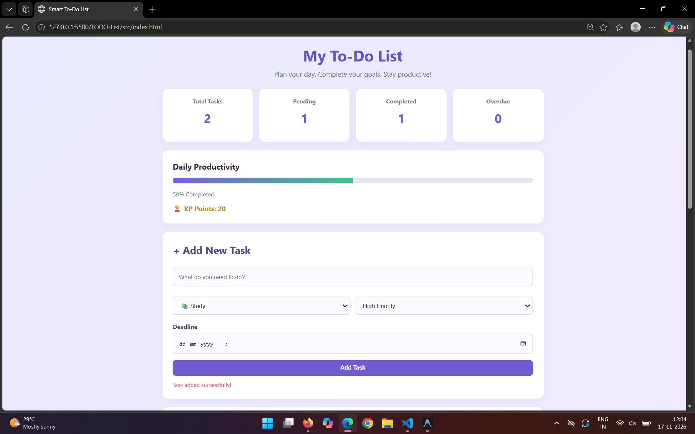
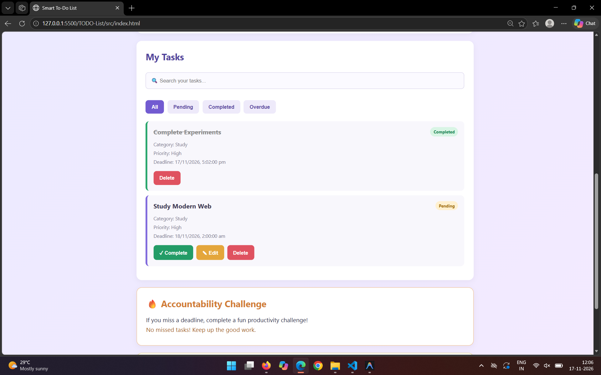
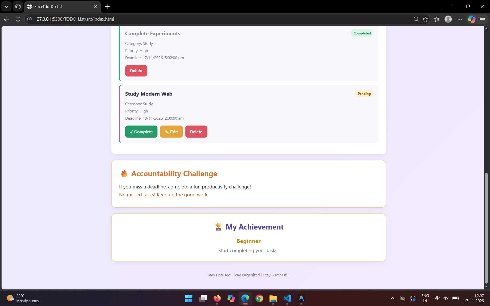

# Ex03 To-Do List using JavaScript
## Date: 17-11-2006

## AIM
To create a To-do Application with all features using JavaScript.

## ALGORITHM
### STEP 1
Build the HTML structure (index.html).

### STEP 2
Style the App (style.css).

### STEP 3
Plan the features the To-Do App should have.

### STEP 4
Create a To-do application using Javascript.

### STEP 5
Add functionalities.

### STEP 6
Test the App.

### STEP 7
Open the HTML file in a browser to check layout and functionality.

### STEP 8
Fix styling issues and refine content placement.

### STEP 9
Deploy the website.

### STEP 10
Upload to GitHub Pages for free hosting.

## PROGRAM
### index.html
```html

<!DOCTYPE html>
<html lang="en">
<head>
    <meta charset="UTF-8">
    <meta name="viewport" content="width=device-width, initial-scale=1.0">
    <title>Smart To-Do List</title>
    <link rel="stylesheet" href="style.css">
</head>
<body>

<div class="container">

    <header>
        <h1> My To-Do List </h1>
        <p>Plan your day. Complete your goals. Stay productive!</p>
    </header>

    <!-- Dashboard -->
    <section class="dashboard">
        <div class="stat">
            <h3>Total Tasks</h3>
            <h2 id="totalCount">0</h2>
        </div>

        <div class="stat">
            <h3>Pending</h3>
            <h2 id="pendingCount">0</h2>
        </div>

        <div class="stat">
            <h3>Completed</h3>
            <h2 id="completedCount">0</h2>
        </div>

        <div class="stat">
            <h3>Overdue</h3>
            <h2 id="overdueCount">0</h2>
        </div>
    </section>

    <!-- Progress -->
    <section class="progress-card">
        <h3>Daily Productivity</h3>
        <div class="progress-bar">
            <div id="progressFill"></div>
        </div>
        <p id="progressText">0% Completed</p>
        <h3 id="xpText">🏆 XP Points: 0</h3>
    </section>

    <!-- Add Task -->
    <section class="form-card">
        <h2>+ Add New Task</h2>

        <input type="text" id="taskInput"
               placeholder="What do you need to do?">

        <div class="form-row">
            <select id="category">
                <option value="Study">📚 Study</option>
                <option value="Personal">👤 Personal</option>
                <option value="Work">💻 Work</option>
                <option value="Fitness">💪 Fitness</option>
                <option value="Other">⭐ Other</option>
            </select>

            <select id="priority">
                <option value="Low">Low Priority</option>
                <option value="Medium" selected>Medium Priority</option>
                <option value="High">High Priority</option>
            </select>
        </div>

        <label for="deadline">Deadline</label>
        <input type="datetime-local" id="deadline">

        <button class="add-btn" id="saveBtn" onclick="addTask()">
            Add Task
        </button>

        <button class="cancel-btn" id="cancelBtn"
                onclick="cancelEdit()" hidden>
            Cancel Edit
        </button>

        <p id="message"></p>
    </section>

    <!-- Task List -->
    <section class="list-card">

        <h2>My Tasks</h2>

        <input type="text" id="searchInput"
               placeholder="🔍 Search your tasks...">

        <div class="filters">
            <button class="filter active" onclick="setFilter('all', this)">All</button>
            <button class="filter" onclick="setFilter('pending', this)">Pending</button>
            <button class="filter" onclick="setFilter('completed', this)">Completed</button>
            <button class="filter" onclick="setFilter('overdue', this)">Overdue</button>
        </div>

        <div id="taskList"></div>

    </section>

    <!-- Challenge Zone -->
    <section class="challenge-card">
        <h2>🔥 Accountability Challenge</h2>
        <p>If you miss a deadline, complete a fun productivity challenge!</p>
        <div id="challengeList">
            No missed tasks. Keep going!
        </div>
    </section>

    <!-- Achievement -->
    <section class="achievement-card">
        <h2>🏆 My Achievement</h2>
        <h3 id="level">Beginner</h3>
        <p id="achievementText">Complete tasks to earn rewards!</p>
    </section>

    <footer>
        <p>Stay Focused | Stay Organized | Stay Successful</p>
    </footer>

</div>

<script src="script.js"></script>
</body>
</html>
```
### style.css
```css

* {
    margin: 0;
    padding: 0;
    box-sizing: border-box;
}

body {
    font-family: 'Segoe UI', Arial, sans-serif;
    background: linear-gradient(135deg, #e8eaff, #f5eaff);
    color: #292b45;
    padding: 25px 15px;
}

.container {
    max-width: 900px;
    margin: auto;
}

header {
    text-align: center;
    padding: 25px 10px;
}

header h1 {
    font-size: 36px;
    color: #6650c8;
    margin-bottom: 10px;
}

header p {
    color: #77758c;
}

.dashboard {
    display: grid;
    grid-template-columns: repeat(4, 1fr);
    gap: 15px;
    margin-bottom: 20px;
}

.stat {
    background: white;
    padding: 20px 10px;
    border-radius: 13px;
    text-align: center;
    box-shadow: 0 4px 15px #0000000c;
}

.stat h3 {
    font-size: 14px;
    color: #77758c;
}

.stat h2 {
    font-size: 29px;
    color: #715bd1;
    margin-top: 10px;
}

.progress-card,
.form-card,
.list-card,
.challenge-card,
.achievement-card {
    background: white;
    padding: 25px;
    border-radius: 14px;
    margin-bottom: 20px;
    box-shadow: 0 4px 15px #0000000c;
}

h2 {
    color: #51439b;
    margin-bottom: 18px;
}

.progress-bar {
    width: 100%;
    height: 13px;
    background: #e8e5f3;
    border-radius: 20px;
    overflow: hidden;
    margin: 15px 0;
}

#progressFill {
    width: 0%;
    height: 100%;
    background: linear-gradient(90deg, #7761d9, #48bd91);
    transition: width 0.4s;
}

#progressText {
    color: #77758c;
    font-size: 14px;
    margin-bottom: 15px;
}

#xpText {
    color: #bc8b20;
    font-size: 16px;
}

input, select {
    width: 100%;
    padding: 13px;
    border: 1px solid #ddd9ee;
    border-radius: 8px;
    margin: 9px 0 15px;
    font-size: 14px;
    background: #fbfaff;
    color: #292b45;
}

input:focus, select:focus {
    outline: none;
    border-color: #8069dc;
}

label {
    font-size: 14px;
    font-weight: bold;
    color: #55516e;
}

.form-row {
    display: flex;
    gap: 12px;
}

button {
    border: none;
    border-radius: 8px;
    padding: 11px 16px;
    cursor: pointer;
    font-weight: 600;
    transition: 0.2s;
}

button:hover {
    opacity: 0.85;
    transform: translateY(-1px);
}

.add-btn {
    background: #725bd1;
    color: white;
    width: 100%;
}

.cancel-btn {
    background: #77758c;
    color: white;
    width: 100%;
    margin-top: 8px;
}

#message {
    margin-top: 12px;
    font-size: 13px;
    color: #d14b58;
}

.filters {
    display: flex;
    gap: 9px;
    flex-wrap: wrap;
    margin: 15px 0 20px;
}

.filter {
    background: #eeeafa;
    color: #5c4a9f;
}

.filter.active {
    background: #725bd1;
    color: white;
}

.task-item {
    background: #f8f7fc;
    padding: 16px;
    border-radius: 10px;
    margin-bottom: 12px;
    border-left: 5px solid #8069dc;
}

.task-item.completed {
    border-left-color: #28a66b;
}

.task-item.overdue {
    border-left-color: #e04e59;
}

.task-top {
    display: flex;
    justify-content: space-between;
    align-items: center;
    gap: 10px;
}

.task-top h3 {
    overflow-wrap: anywhere;
    color: #39354f;
    font-size: 17px;
}

.task-item.completed h3 {
    text-decoration: line-through;
    color: #888;
}

.task-details {
    font-size: 13px;
    color: #77758c;
    margin-top: 10px;
    line-height: 1.8;
}

.task-actions {
    display: flex;
    flex-wrap: wrap;
    gap: 8px;
    margin-top: 13px;
}

.done-btn {
    background: #239c67;
    color: white;
}

.edit-btn {
    background: #e4a63b;
    color: white;
}

.delete-btn {
    background: #df5260;
    color: white;
}

.status {
    display: inline-block;
    padding: 5px 9px;
    border-radius: 20px;
    font-size: 11px;
    font-weight: bold;
}

.pending-status {
    background: #fff0cf;
    color: #a16b08;
}

.completed-status {
    background: #d9f5e5;
    color: #16844f;
}

.overdue-status {
    background: #ffe0e2;
    color: #c52f3d;
}

.priority {
    font-size: 12px;
    font-weight: bold;
}

.empty {
    text-align: center;
    padding: 25px;
    color: #89869b;
}

.challenge-card {
    border: 1px solid #f1c7a0;
}

.challenge-card h2 {
    color: #d17c36;
}

#challengeList {
    color: #a65d24;
    line-height: 2;
}

.challenge-item {
    padding: 10px;
    background: #fff7ed;
    border-radius: 8px;
    margin-top: 9px;
}

.achievement-card {
    text-align: center;
    border: 1px solid #e7d58c;
}

.achievement-card h3 {
    color: #bb901e;
    margin-bottom: 8px;
}

.achievement-card p {
    color: #77758c;
}

footer {
    text-align: center;
    color: #77758c;
    padding: 15px;
    font-size: 13px;
}

@media (max-width: 650px) {
    .dashboard {
        grid-template-columns: repeat(2, 1fr);
    }

    .form-row {
        flex-direction: column;
        gap: 0;
    }

    header h1 {
        font-size: 28px;
    }

    .progress-card,
    .form-card,
    .list-card,
    .challenge-card,
    .achievement-card {
        padding: 18px;
    }
}
```
### script.js
```js

// SMART TO-DO LIST APPLICATION

// Load saved data
let tasks = JSON.parse(
    localStorage.getItem("smartTasks")
) || [];

let xp = Number(localStorage.getItem("smartXP")) || 0;

let currentFilter = "all";
let editingId = null;

// Productivity challenges
const challenges = [
    "📚 Revise a topic for 15 minutes.",
    "🧹 Organize your study table.",
    "📖 Read 5 pages of a useful book.",
    "📵 Stay away from social media for 20 minutes.",
    "✍️ Write down three goals for tomorrow.",
    "💻 Practice coding for an extra 15 minutes.",
    "🧠 Solve five aptitude questions."
];

// Save tasks and XP
function saveData() {
    localStorage.setItem(
        "smartTasks",
        JSON.stringify(tasks)
    );

    localStorage.setItem("smartXP", xp);
}

// Check missed deadlines
function checkDeadlines() {
    const now = Date.now();

    tasks.forEach(task => {
        if (
            !task.completed &&
            !task.punishment &&
            new Date(task.deadline).getTime() < now
        ) {
            const random = Math.floor(
                Math.random() * challenges.length
            );

            task.punishment = challenges[random];
        }
    });

    saveData();
}

// Add or update task
function addTask() {
    const name = document.getElementById("taskInput")
        .value.trim();

    const category = document.getElementById("category").value;

    const priority = document.getElementById("priority").value;

    const deadline = document.getElementById("deadline").value;

    const message = document.getElementById("message");

    if (!name || !deadline) {
        message.textContent =
            "Please enter a task and deadline!";
        return;
    }

    const deadlineTime = new Date(deadline).getTime();

    if (isNaN(deadlineTime) || deadlineTime <= Date.now()) {
        message.textContent =
            "Please select a valid future deadline!";
        return;
    }

    if (editingId !== null) {
        const task = tasks.find(t => t.id === editingId);

        if (task) {
            task.name = name;
            task.category = category;
            task.priority = priority;
            task.deadline = deadline;
            task.punishment = null;
        }

        editingId = null;

        document.getElementById("saveBtn").textContent =
            "Add Task";

        document.getElementById("cancelBtn").hidden = true;

        message.textContent = "Task updated successfully!";
    } else {
        tasks.push({
            id: Date.now() + Math.random(),
            name: name,
            category: category,
            priority: priority,
            deadline: deadline,
            completed: false,
            punishment: null,
            xpAwarded: false
        });

        message.textContent = "Task added successfully!";
    }

    document.getElementById("taskInput").value = "";
    document.getElementById("deadline").value = "";

    saveData();
    displayTasks();
}

// Edit task
function editTask(id) {
    const task = tasks.find(t => t.id === id);

    if (!task || task.completed) return;

    document.getElementById("taskInput").value = task.name;
    document.getElementById("category").value = task.category;
    document.getElementById("priority").value = task.priority;
    document.getElementById("deadline").value = task.deadline;

    editingId = id;

    document.getElementById("saveBtn").textContent =
        "Update Task";

    document.getElementById("cancelBtn").hidden = false;

    document.getElementById("message").textContent =
        "Editing selected task.";

    window.scrollTo({
        top: 0,
        behavior: "smooth"
    });
}

// Cancel editing
function cancelEdit() {
    editingId = null;

    document.getElementById("taskInput").value = "";
    document.getElementById("deadline").value = "";

    document.getElementById("saveBtn").textContent =
        "Add Task";

    document.getElementById("cancelBtn").hidden = true;

    document.getElementById("message").textContent = "";

    displayTasks();
}

// Complete task
function completeTask(id) {
    const task = tasks.find(t => t.id === id);

    if (!task || task.completed) return;

    task.completed = true;
    task.completedAt = Date.now();

    if (!task.xpAwarded) {
        if (task.completedAt <= new Date(task.deadline).getTime()) {
            xp += 20;

            alert("🎉 Excellent! Task completed on time. +20 XP!");
        } else {
            alert("Task completed late! Keep improving your time management.");
        }

        task.xpAwarded = true;
    }

    saveData();
    displayTasks();
}

// Delete task
function deleteTask(id) {
    if (!confirm("Are you sure you want to delete this task?")) {
        return;
    }

    tasks = tasks.filter(t => t.id !== id);

    if (editingId === id) {
        cancelEdit();
    }

    saveData();
    displayTasks();
}

// Filter tasks
function setFilter(filter, button) {
    currentFilter = filter;

    document.querySelectorAll(".filter").forEach(btn => {
        btn.classList.remove("active");
    });

    button.classList.add("active");

    displayTasks();
}

// Search tasks
document.getElementById("searchInput")
    .addEventListener("input", displayTasks);

// Display all tasks
function displayTasks() {
    checkDeadlines();

    const list = document.getElementById("taskList");

    const search = document.getElementById("searchInput")
        .value.toLowerCase().trim();

    const now = Date.now();

    list.innerHTML = "";

    const filteredTasks = tasks.filter(task => {
        const overdue =
            !task.completed &&
            new Date(task.deadline).getTime() < now;

        const matchesSearch =
            task.name.toLowerCase().includes(search);

        let matchesFilter = true;

        if (currentFilter === "pending") {
            matchesFilter = !task.completed && !overdue;
        } else if (currentFilter === "completed") {
            matchesFilter = task.completed;
        } else if (currentFilter === "overdue") {
            matchesFilter = overdue;
        }

        return matchesSearch && matchesFilter;
    });

    // Sort tasks by deadline
    filteredTasks.sort((a, b) =>
        new Date(a.deadline) - new Date(b.deadline)
    );

    if (filteredTasks.length === 0) {
        list.innerHTML =
            '<div class="empty">No tasks found. Add a new task!</div>';
    }

    filteredTasks.forEach(task => {
        const overdue =
            !task.completed &&
            new Date(task.deadline).getTime() < now;

        const div = document.createElement("div");

        div.className = "task-item";

        if (task.completed) {
            div.classList.add("completed");
        } else if (overdue) {
            div.classList.add("overdue");
        }

        const status = task.completed
            ? "Completed"
            : overdue ? "Overdue" : "Pending";

        const statusClass = task.completed
            ? "completed-status"
            : overdue ? "overdue-status" : "pending-status";

        const date = new Date(task.deadline)
            .toLocaleString();

        const title = document.createElement("h3");
        title.textContent = task.name;

        const statusBadge = document.createElement("span");
        statusBadge.className = "status " + statusClass;
        statusBadge.textContent = status;

        const top = document.createElement("div");
        top.className = "task-top";

        top.append(title, statusBadge);

        const details = document.createElement("div");
        details.className = "task-details";

        const category = document.createElement("p");
        category.textContent = "Category: " + task.category;

        const priority = document.createElement("p");
        priority.textContent = "Priority: " + task.priority;

        const deadline = document.createElement("p");
        deadline.textContent = "Deadline: " + date;

        details.append(category, priority, deadline);

        if (task.punishment) {
            const challenge = document.createElement("p");
            challenge.textContent = "🔥 Challenge: " + task.punishment;
            details.appendChild(challenge);
        }

        const actions = document.createElement("div");
        actions.className = "task-actions";

        if (!task.completed) {
            const doneButton = document.createElement("button");
            doneButton.className = "done-btn";
            doneButton.textContent = "✓ Complete";

            doneButton.addEventListener("click", () => {
                completeTask(task.id);
            });

            const editButton = document.createElement("button");
            editButton.className = "edit-btn";
            editButton.textContent = "✎ Edit";

            editButton.addEventListener("click", () => {
                editTask(task.id);
            });

            actions.append(doneButton, editButton);
        }

        const deleteButton = document.createElement("button");
        deleteButton.className = "delete-btn";
        deleteButton.textContent = "Delete";

        deleteButton.addEventListener("click", () => {
            deleteTask(task.id);
        });

        actions.appendChild(deleteButton);

        div.append(top, details, actions);

        list.appendChild(div);
    });

    updateDashboard();
}

// Update dashboard statistics
function updateDashboard() {
    const now = Date.now();

    const completed = tasks.filter(t => t.completed).length;

    const overdue = tasks.filter(t =>
        !t.completed &&
        new Date(t.deadline).getTime() < now
    ).length;

    const pending = tasks.filter(t =>
        !t.completed &&
        new Date(t.deadline).getTime() >= now
    ).length;

    document.getElementById("totalCount").textContent =
        tasks.length;

    document.getElementById("pendingCount").textContent =
        pending;

    document.getElementById("completedCount").textContent =
        completed;

    document.getElementById("overdueCount").textContent =
        overdue;

    const percentage = tasks.length === 0
        ? 0
        : Math.round((completed / tasks.length) * 100);

    document.getElementById("progressFill").style.width =
        percentage + "%";

    document.getElementById("progressText").textContent =
        percentage + "% Completed";

    document.getElementById("xpText").textContent =
        "🏆 XP Points: " + xp;

    updateAchievements();
    updateChallenges();
}

// Update achievements
function updateAchievements() {
    let level = "Beginner";

    let message = "Start completing your tasks!";

    if (xp >= 100) {
        level = "Silver Achiever";
        message = "Great progress! Keep going!";
    }

    if (xp >= 300) {
        level = "Gold Achiever";
        message = "Excellent productivity!";
    }

    if (xp >= 500) {
        level = "Productivity Champion";
        message = "You have mastered your tasks!";
    }

    document.getElementById("level").textContent = level;

    document.getElementById("achievementText").textContent =
        message;
}

// Show missed deadline challenges
function updateChallenges() {
    const zone = document.getElementById("challengeList");

    zone.innerHTML = "";

    const missedTasks = tasks.filter(t => t.punishment);

    if (missedTasks.length === 0) {
        zone.textContent =
            "No missed tasks! Keep up the good work.";
        return;
    }

    missedTasks.forEach(task => {
        const item = document.createElement("div");

        item.className = "challenge-item";

        item.textContent =
            "⚠ " + task.name + " — " + task.punishment;

        zone.appendChild(item);
    });
}

// Check deadlines automatically
setInterval(displayTasks, 10000);

// Initial application loading
displayTasks();
```


## OUTPUT










## RESULT
The program for creating To-do list using JavaScript is executed successfully.